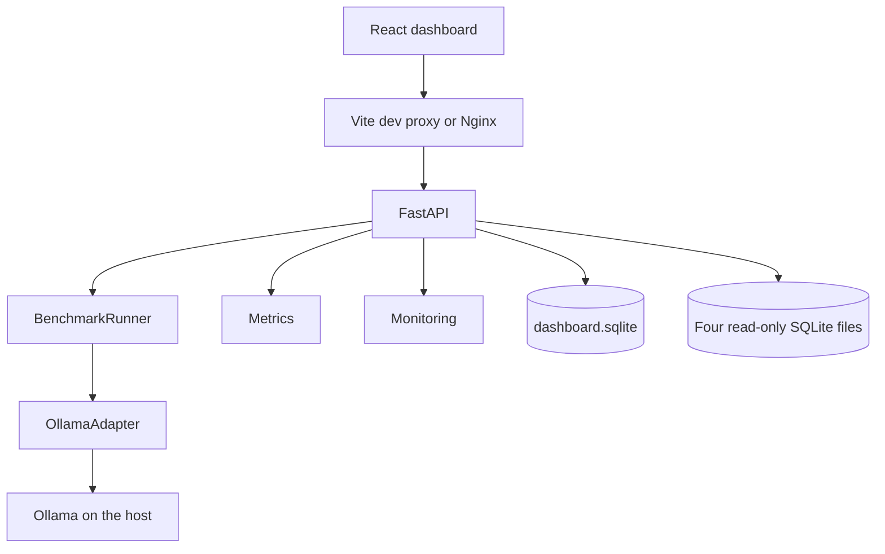
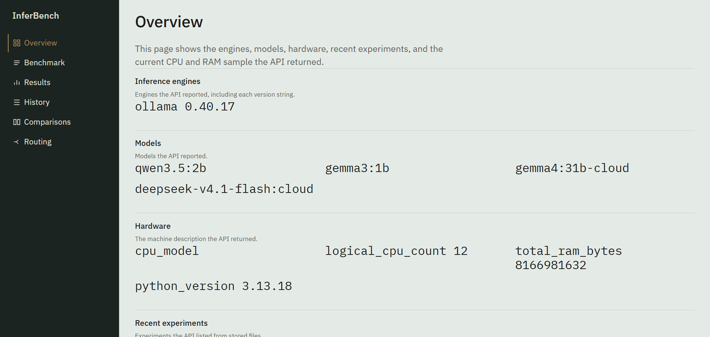
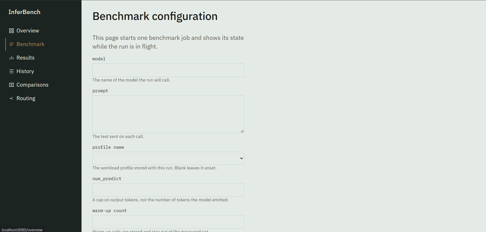
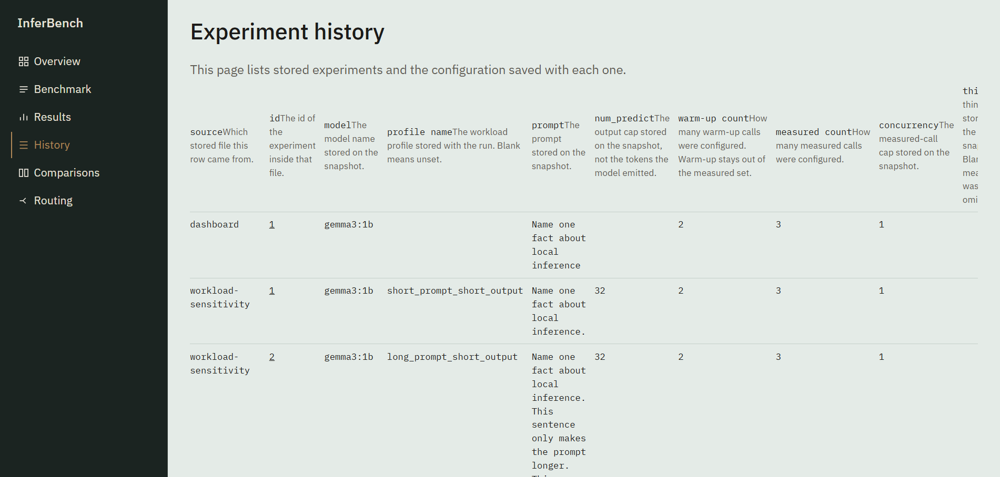
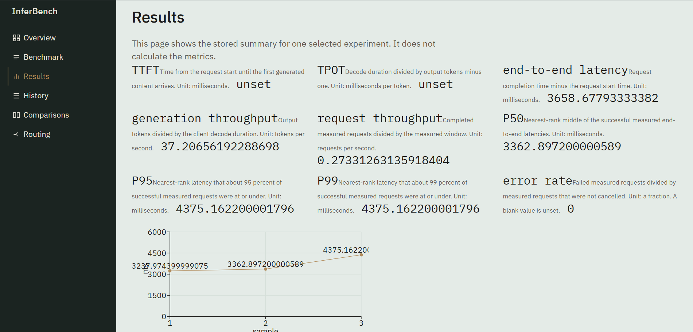
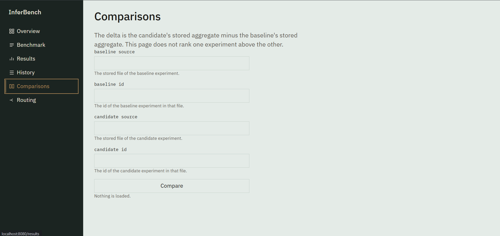
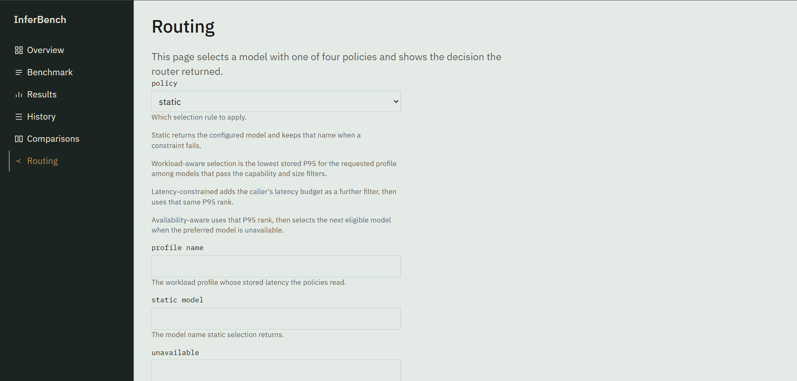

# InferBench

InferBench measures local LLM inference through Ollama. It records client-observed latency, throughput, error rate, and CPU and RAM, then stores the run so a later session can compare it.

The dashboard reads those stored payloads. It does not calculate TTFT, TPOT, percentiles, throughput, or error rate. A number on the screen is a saved payload. This document is not a measurement.

## Problem

A local model server returns its own timings and token counts. Those fields are useful, and they are not the wait the client observed. InferBench keeps the two clocks apart, runs a controlled workload, and stores the rows, the samples, and the aggregates so a comparison reads the database instead of calling the model again.

## Capabilities

- Streaming benchmark jobs against a local Ollama server, with warm-up, repeated measured calls, and a concurrency cap.
- Client-observed TTFT, TPOT, end-to-end latency, generation throughput, request throughput, nearest-rank P50, P95, and P99, and error rate.
- CPU and RAM samples taken while a run is in flight. A sample is not a latency.
- Stored workload, model, serving, and routing experiments, plus a comparison of two stored experiments.
- Four routing policies over a catalog the caller already filled: static, workload-aware, latency-constrained, and availability-aware.
- A React dashboard for overview, a new job, history, one result, a comparison, and a routing decision.

Ollama is the only adapter. llama.cpp is not built.

## Architecture



`frontend/src/` talks only to `/api`. In development, Vite proxies `/api` to `http://127.0.0.1:8000`. In Compose, Nginx does the same proxy to the `api` service.

`app/main.py` and `app/api/` open SQLite, call `summarize`, and start the runner. `app/benchmark/runner.py` streams through `app/inference/ollama.py` and stamps the first non-empty response on the runner clock. `app/metrics/` turns stored rows into aggregates. `app/monitoring/` owns the CPU and RAM samples and the hardware identity. The runner calls the sampler the API passes in. Monitoring does not compute a latency.

New jobs are written to `experiments/results/dashboard.sqlite`. These four files are opened read-only:

- `experiments/results/workload-sensitivity.sqlite`
- `experiments/results/model-comparison.sqlite`
- `experiments/results/serving-config.sqlite`
- `experiments/results/routing-effectiveness.sqlite`

`job_status` is the API column. The names are `PENDING`, `RUNNING`, `COMPLETED`, `FAILED`, and `CANCELLED`. Request rows stay `success` and `error_type`. The runner does not set the five status names.

## Technology stack

| Piece | What this repository uses |
|---|---|
| Language | Python 3.13 |
| API | FastAPI 0.141.1, uvicorn 0.52.4 |
| HTTP client | httpx 0.28.1 |
| Database | SQLite through SQLAlchemy 2.0.43 |
| Samples | psutil 7.2.2 |
| Tests | pytest 8.4.2, pytest-asyncio 1.4.0 |
| Dashboard | React 19, Vite 8, React Router 7, Recharts 3 |
| Dashboard image | Node 24.19.0, then Nginx |
| Inference | Ollama on the host. One adapter, `app/inference/ollama.py` |

Pins are in `requirements.txt`, `requirements-dev.txt`, and `frontend/package-lock.json`. A pin is not a latency.

## How a benchmark job works

1. `POST /api/jobs` stores `PENDING` and returns the id. It does not wait for the model.
2. The task sets `RUNNING`, reads the Ollama version, and stores a hardware snapshot.
3. The runner checks the model, streams the warm-up calls one at a time, then streams the measured calls under the concurrency cap.
4. Each call records client start, the first non-empty content, and client end. Provider token counts and server durations stay in their own fields.
5. A finished run calls `summarize` and stores `COMPLETED`.
6. The Benchmark page polls `GET /api/jobs/{id}` about every 200 ms while the status is `PENDING` or `RUNNING`.

A timeout or a malformed response on one call is one request row. The job can still finish `COMPLETED`. A missing model, or a failure while reading the engine version, is `FAILED` and does not call `generate_stream`. Cancel stores `CANCELLED`, does not fall back, and stores retry count 0.

`think` true is rejected and does not start a job. For `qwen3.5:2b` the API sends `think` false. For `gemma3:1b` it omits `think`. The adapter timeout stays 120 seconds.

Live job state is held in memory. After the API process stops, `GET /api/jobs/{id}` cannot see that job. History and Results still read SQLite.

## Benchmark methodology

The controlled procedure is in [docs/methodology.md](docs/methodology.md). The prototype defaults are:

- 2 warm-up calls, stored and excluded from every aggregate
- 3 measured calls
- measured concurrency 1, unless the caller sets a higher cap
- streaming for every warm-up call and every measured call

Client-observed time is the benchmark process clock around the HTTP stream. Ollama's `prompt_eval_duration` and `eval_duration` are server-reported nanoseconds. They are stored and they are not copied into TTFT or end-to-end latency. HTTP chunks are not tokens. `eval_count` is the provider output-token count.

The published experiments each use 3 measured calls. Three observations do not support a variance estimate, and they do not support a strong claim about a tail. Nearest-rank P95 and P99 on three values both land on the largest observation. Procedure step 9, repeating a run for variance, was not performed.

A longer `num_predict` is a cap. It is not proof the model emitted that many tokens.

## Metrics

`app/metrics/` owns the formulas. The sheet is [docs/metrics.md](docs/metrics.md). The dashboard does not recompute them.

| Metric | Definition in this repository |
|---|---|
| TTFT | First non-empty content minus client start, in milliseconds. Unset when the stamp is missing. |
| Decode duration | Client end minus first content, in milliseconds. |
| TPOT | Decode duration divided by `eval_count - 1`. Unset when the output-token count is below 2. |
| End-to-end latency | Client end minus client start, in milliseconds. |
| Generation throughput | Sum of qualifying `eval_count` divided by the sum of client decode time, in tokens per second. Warm-up stays out. |
| Request throughput | Completed measured requests divided by the measured window, in requests per second. The window is the latest measured client end minus the earliest measured client start. |
| P50, P95, P99 | Nearest-rank on successful measured end-to-end latencies. Rank is `ceil(percent * n / 100)`, 1-based. The result is an observed latency. |
| Median | The ordinary middle. An even count averages the two middle values, so median can differ from nearest-rank P50. |
| Error rate | Failed measured requests divided by measured requests that were not cancelled. `CancelledError` is outside both counts. |

Warm-up rows stay out of every aggregate. `app/metrics/statistics.py` implements the percentile rank. With three measured calls, a percentile is a description of that small sample, not a stable tail estimate.

## Experiments

The index is [docs/experiments.md](docs/experiments.md). Each findings file was written from a SQLite file that is already in the repository. These pages describe stored runs. They are not a fresh reproduction, and they do not name a winner.

| Series | What it varied | Read |
|---|---|---|
| Workload sensitivity | Four prompt and output profiles on `gemma3:1b`. Warm-up 2, measured 3, concurrency 1. | [docs/workload-findings.md](docs/workload-findings.md) |
| Model comparison | The same four profiles on `qwen3.5:2b` with `think` false, then on `gemma3:1b` with `think` omitted. This is a cross-model comparison. It is not a same-model quantization comparison. Experiment G was not run. | [docs/model-findings.md](docs/model-findings.md) |
| Serving configuration | `short_prompt_short_output`. Concurrency 1, then 2, then 4, with `num_thread` omitted. Then concurrency 1 with `num_thread` 4, then the machine's logical CPU count. One factor at a time. Concurrency 8 and `num_ctx` were not varied. | [docs/serving-findings.md](docs/serving-findings.md) |
| Stored-result analysis | Deltas between stored aggregates. Candidate minus baseline. No new Ollama call. | [docs/analysis-findings.md](docs/analysis-findings.md) |
| Routing | `short_prompt_short_output` under static, workload-aware, latency-constrained, and availability-aware, against a `gemma3:1b` static baseline. The stored fallback count for that run is 0. Fallback did not occur in the recorded run. | [docs/routing-findings.md](docs/routing-findings.md) |

Failure behavior that the tests already lock is in [docs/failures.md](docs/failures.md). The machine and the comparison rule are in [docs/environment.md](docs/environment.md). Model metadata from the Day 2 check is in [docs/model-check.md](docs/model-check.md). That check is metadata, not a latency.

## Dashboard

The landing sentence is "An engineering platform for measuring local LLM inference performance." The name InferBench under that sentence opens the dashboard.

| Page | Path | What it shows from the API |
|---|---|---|
| Overview | `/overview` | Engines, models, hardware, recent experiments, and the current CPU and RAM sample. A failed load says "The load failed." and does not invent a sample or a model list. |
| Benchmark | `/benchmark` | Posts a run. Shows the job state, the succeeded count, the failed count, and the latest sample. `think` offers omitted and false. `think` true is not offered. |
| History | `/history` | Stored experiments, including the source file. A null `job_status` is a blank cell. |
| Results | `/results` | The nine stored metrics, and a chart of the measured `end_to_end_ms` values it was given. No selected id passes no series. |
| Comparisons | `/comparisons` | Two stored experiments. Deltas, both phase labels, the differing snapshot fields, and the sign sentence only when the payload includes one. |
| Routing | `/routing` | One policy and the catalog row entered on the form. Selected model, preferred model, reason, fallback count, and failed constraints. |

A stopped Ollama leaves Overview on "The load failed." A number on the screen is a stored payload. Pictures of the six pages are in [Application screenshots](#application-screenshots).

## Application screenshots

These six images are the dashboard as it looked in one session. They are layout pictures. A number visible in a picture is the payload that session already had. It is not a new measurement, and this page does not treat any picture as a ranking. The files are in `docs/images/`.

### Overview



Overview after a successful load. The frame shows the engine name and version, the models the API returned, and the hardware fields: CPU model, logical CPU count, total RAM, and Python version. The Recent experiments heading is at the bottom edge. The experiment list and the current CPU and RAM sample are below this crop.

### Benchmark



The Benchmark form before a job is started. The picture stops at the warm-up field. It does not show a finished job, a status, or a sample.

### History



Stored experiments. The table is wider than the content area, and this is the only History image. It shows the left-hand columns, from the source file through concurrency. Later columns, including `think`, `num_thread`, and job status, sit to the right of this frame and move with the table's horizontal scroll. The page scrollbar moves through the rows.

### Results



One experiment opened from History. The page shows the stored metric captions and a chart of the measured end-to-end samples it was given. The dashboard does not calculate those metrics. The figures in the picture belong to that stored run. They are not repeated here.

### Comparisons



The Comparisons form before two stored experiments are submitted. The page states that a delta is candidate minus baseline and that the page does not rank one experiment above the other. This picture has no delta table.

### Routing



The Routing form with the static policy selected and the catalog fields empty. The policy notes on the form describe the four rules. This picture does not show a selected model, a fallback count, or a failed constraint.

## Installation

A clean machine install was not verified while this page was written. Run the checks in [Running tests](#running-tests) on the machine you use.

Ollama stays on the host. The stored experiments used `gemma3:1b` and `qwen3.5:2b`. This repository does not download a model. A new job needs the model name you submit to already be present in that Ollama server.

Python dependencies, from the repository root:

```text
python -m pip install -r requirements.txt
```

Test dependencies:

```text
python -m pip install -r requirements-dev.txt
```

Start the API:

```text
python -m app.main
```

`python -m app.main` listens on `127.0.0.1:8000` unless `INFERBENCH_HOST` and `INFERBENCH_PORT` are set. An absent variable keeps those defaults. An absent `OLLAMA_HOST` keeps `http://127.0.0.1:11434`. Those names are listed in `.env.example`.

Dashboard, in `frontend/`:

```text
npm ci
npm run dev
```

`npm run dev` uses the Vite proxy, which stays `http://127.0.0.1:8000`. The dev server prints its own URL.

## Docker

Compose starts `api` and `web` only. It does not start Ollama, and it does not download a model.

```text
docker compose up
```

The API publishes host port 8000. The dashboard publishes host port 8080. Inside the API container, `OLLAMA_HOST` is `http://host.docker.internal:11434`. Compose adds `host-gateway` so that name reaches Ollama on the host. `experiments/results` is mounted so the dashboard database and the four result files stay on the host.

`docker compose config` checks the file. It does not start the stack, and it is not a measurement. This page does not claim that a container was started while the page was written.

## Running benchmarks

The scripts under `scripts/` call Ollama and write the SQLite file and the findings file for that series. Running one of them replaces that series. They are not part of the test suite.

| Script | Writes |
|---|---|
| `scripts/run_workload_sensitivity.py` | `experiments/results/workload-sensitivity.sqlite` and `docs/workload-findings.md` |
| `scripts/run_model_comparison.py` | `experiments/results/model-comparison.sqlite` and `docs/model-findings.md` |
| `scripts/run_serving_config.py` | `experiments/results/serving-config.sqlite` and `docs/serving-findings.md` |
| `scripts/compare_stored.py` | `docs/analysis-findings.md` from the three files above. It does not call Ollama. |
| `scripts/run_routing_experiment.py` | `experiments/results/routing-effectiveness.sqlite` and `docs/routing-findings.md` |

To inspect the runs that are already stored, read the findings files. To start one new job from the dashboard, use Benchmark. That job is written to `experiments/results/dashboard.sqlite`, which is a local working file and is not one of the four stored series.

## Running tests

From the repository root:

```text
python -m pytest
```

In `frontend/`:

```text
npm test
npm run build
```

Compose file check, from the repository root:

```text
docker compose config
```

On 2026-11-24 a local session recorded `python -m pytest` at 172 passed, `npm test` at 20 passed, `npm run build` exiting 0, and `docker compose config` valid. Those are test and setup checks from that session. They are not measurements. Run the commands again on a new clone. Pytest does not contact Ollama. Frontend tests use mocked responses. No CI badge is shown here, because a GitHub Actions run of `.github/workflows/ci.yml` was not inspected for this page.

## Repository structure

```text
app/                  API, runner, Ollama adapter, metrics, monitoring, database, routing
frontend/src/         React dashboard
tests/unit/           Fake-adapter and temporary-database tests
tests/integration/    In-process job path
scripts/              Live experiment scripts
experiments/results/  Stored SQLite series
docs/                 Methodology, metrics, findings, failure notes
```

## Engineering decisions

- The metrics module does not call Ollama. The adapter does not compute percentiles.
- Server durations stay in nanoseconds. Client TTFT and end-to-end latency use the runner clock.
- The dashboard reads `/api` and renders the payload. A chart is a plot of `end_to_end_ms` values it was given.
- `app/optimization/` subtracts stored aggregates. It does not name a winner.
- `app/routing/` selects from a catalog the caller filled. It does not open the database and it does not call the model.
- Qwen versus Gemma in the stored model series is a cross-model comparison. The models differ in architecture, parameter count, and quantization.
- The published sample is three measured calls. That default keeps a run small on a CPU-only machine. It also limits what a percentile can mean.

## Known limitations

- Each published experiment used three measured calls.
- No repeated-trial variance study was run. Procedure step 9 was not performed.
- There is no GPU metric. Samples are CPU percent and RAM.
- Live job state is in memory and is not restored after a process restart.
- The API has no authentication. The local default bind is `127.0.0.1`. The container listens on `0.0.0.0` inside the Compose network and publishes host port 8000.
- Thinking on versus off was not run. `think` true does not start a job.
- Concurrency 8 was not run.
- `num_ctx` was not varied. It is not a request field.
- A same-model quantization comparison was not run.
- The llama.cpp adapter is not implemented.
- CSV and JSON export are not implemented.

## Future work

The items in [Known limitations](#known-limitations) are not built. They are recorded so a reader does not treat them as present. This repository does not schedule them.
